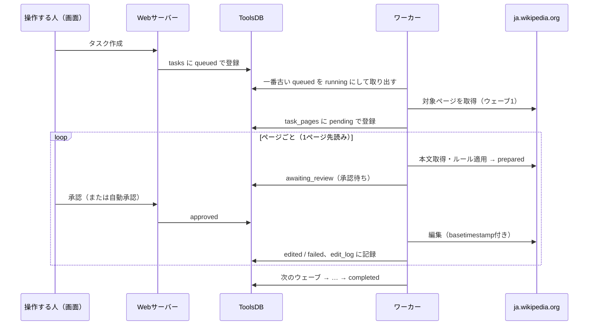
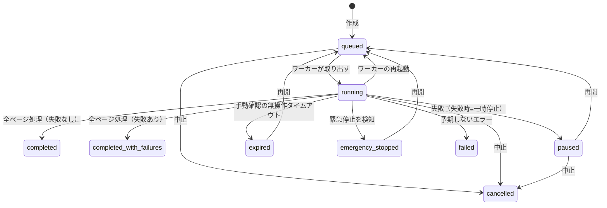
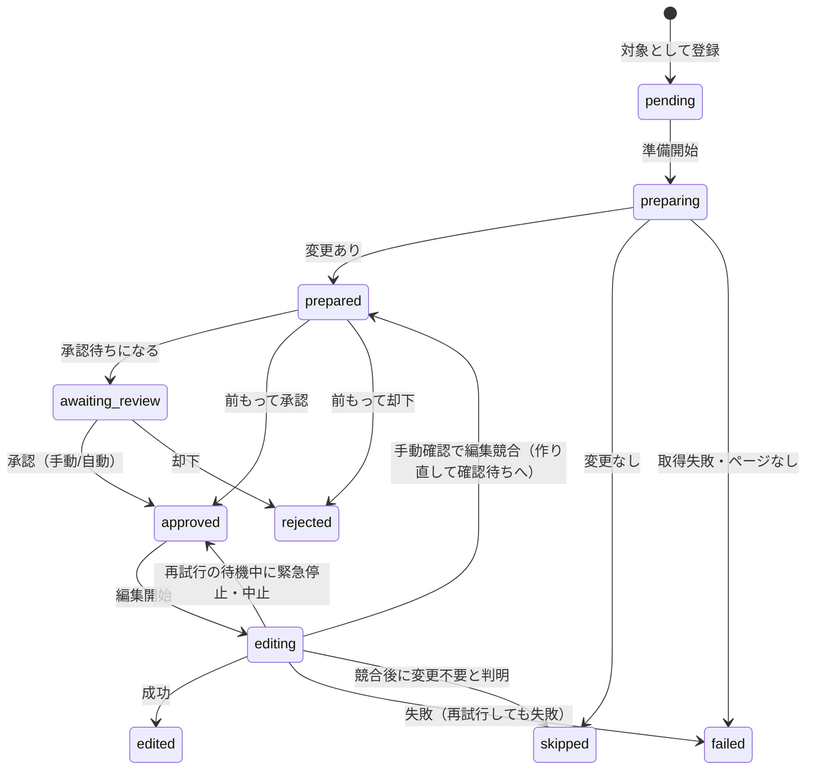

# タスクの流れと各動作

タスクを作ってから終わるまでに、ワーカーと画面が何をしているかの説明です。画面の操作方法は [使い方ガイド](user-guide.md) を参照してください。

- [全体の流れ](#全体の流れ)
- [タスクの状態](#タスクの状態)
- [ページの状態](#ページの状態)
- [ウェーブ](#ウェーブ)
- [1ページ先読み](#1ページ先読み)
- [承認（自動更新・手動確認・前もって承認）](#承認自動更新手動確認前もって承認)
- [編集](#編集)
- [編集の失敗と再試行](#編集の失敗と再試行)
- [null edit と purge（Category系のウェーブ1のあと）](#null-edit-と-purgecategory系のウェーブ1のあと)
- [緊急停止](#緊急停止)
- [中止・一時停止・期限切れ・再開](#中止一時停止期限切れ再開)
- [ワーカーの再起動](#ワーカーの再起動)
- [失敗ページのみ再試行](#失敗ページのみ再試行)
- [進捗と最終的な状態](#進捗と最終的な状態)
- [記録（実行ログ・編集ログ・警告）](#記録実行ログ編集ログ警告)
- [画面の更新タイミング](#画面の更新タイミング)

---

## 全体の流れ

- ワーカーは**1件ずつ**タスクを処理します（同時に複数のタスクは動かしません）。待機中のタスクは作成が古い順に処理されます。
- タスクの設定（ルール・編集設定など）は作成時にDBへ保存され、実行中に変えられるのは確認モードだけです。

## タスクの状態

| 状態 | 表示 | 意味 |
|---|---|---|
| `queued` | 待機中 | ワーカーが取り出すのを待っている |
| `running` | 実行中 | ワーカーが処理している |
| `paused` | 一時停止 | 失敗時の挙動が「一時停止する」で、失敗したページが出た |
| `emergency_stopped` | 緊急停止 | 緊急停止を検知して中断した |
| `expired` | 期限切れ | 手動確認で、無操作タイムアウトまで操作が無かった |
| `cancelled` | キャンセル | 画面から中止した（再開できない） |
| `completed` | 完了 | すべてのページの処理が終わり、失敗したページが無い |
| `completed_with_failures` | 完了（一部失敗） | すべてのページの処理が終わったが、失敗したページがある |
| `failed` | 失敗 | ログイン失敗などの予期しないエラーで終わった |

## ページの状態

| 状態 | 表示 | 意味 |
|---|---|---|
| `pending` | 待機中 | まだ準備していない |
| `preparing` | 準備中 | 本文を取得してルールを適用している |
| `prepared` | 準備完了 | 新しい本文ができた（差分を見られる） |
| `awaiting_review` | 確認待ち | ワーカーが承認を待っている |
| `approved` | 承認済み | 承認された（まもなく編集） |
| `editing` | 編集中 | 編集APIを呼んでいる、または一時的な失敗の再試行を待っている |
| `edited` | 編集済み | 編集に成功した |
| `skipped` | スキップ | ルールを適用しても変更が無かった |
| `rejected` | 却下 | 人が却下した |
| `failed` | 失敗 | 準備または編集に失敗した（理由はページ一覧に表示） |

## ウェーブ

ルールの種類によって、対象ページを何回に分けて取得・編集するか（ウェーブ数）が決まります。1つのタスクに複数の種類のルールがある場合は、最も多いウェーブ数で動きます。

| ウェーブ数 | ルール | ウェーブ1 | ウェーブ2 | ウェーブ3 |
|---|---|---|---|---|
| 1 | テンプレート置換・リンク解除・subst化・カスタム・失敗ページの再試行 | すべての対象 | — | — |
| 2 | リンク置換・リンク置換2・節・表示名指定・外部リンクの付け替え | Template名前空間の対象 | 取り直したその他の対象 | — |
| 3 | Category置換・Category除去 | Template名前空間のメンバー（→null edit） | 取り直したその他のメンバー | 標準名前空間のカテゴリ名の記述 |

- **なぜテンプレートを先に直すのか**: テンプレートの中のリンクやカテゴリを直すと、それを使っているページの「リンク元」「カテゴリのメンバー」から外れます。先にテンプレートを直してから対象を取り直すことで、本文に直接書かれているページだけを編集でき、無駄な取得やスキップを減らせます。
- 各ウェーブの対象は、**前のウェーブが終わってから**取得します。前のウェーブが0件でも、次のウェーブは必ず実行します。
- 1つのウェーブで同じページに複数のルールが当てはまる場合は、まとめて1回の編集にします。別のウェーブで同じページが再び対象になった場合は、最新の本文から改めて準備します（変更が無ければスキップ）。
- 対象の取得は1ルールあたり最大5000件です（`MAX_RESULTS`）。上限で打ち切った場合は実行ログに警告が出ます。

## 1ページ先読み

ワーカーは、今のページの承認を待っている間に、**次のページを裏で準備**しておきます（仕様書9.2節）。

- 準備では、ページの最新版を取得し、ルールを適用して新しい本文と差分を作ります。
- 承認されたら、すぐに編集できます。編集時には準備した時点の版を基準に送るので、準備のあとに他の人が編集していれば MediaWiki が編集競合として検出します。→ [編集の失敗と再試行](#編集の失敗と再試行)

## 承認（自動更新・手動確認・前もって承認）

ページが「確認待ち」になると、ワーカーは次のどれかが起きるまで待ちます（既定0.5秒ごとに確認。`REVIEW_POLL_INTERVAL_MS`）。

| 起きたこと | 結果 |
|---|---|
| 画面で承認された | 編集する |
| 画面で却下された | 編集せずに次のページへ |
| 自動更新モードで、待機秒数が経った | 自動で承認して編集する（予定時刻ちょうどに動く） |
| 手動確認モードで、無操作タイムアウトを過ぎた | タスクを期限切れにする |
| 緊急停止・中止・一時停止された | 待つのをやめる（ページは確認待ちのまま。再開時に準備からやり直す） |

- **自動承認の待機時間**は、ページが「確認待ちになった時点」から数えます（先読みで準備された時刻ではありません）。
- **確認モードの切り替え**: 実行中でもタスク詳細から切り替えられ、次の確認から反映されます。手動確認に切り替えると、無操作タイムアウトはその時点から数え直します（タスクに設定が無ければ72時間）。
- **前もって承認・却下**: 前のページを編集している間（または編集間隔をあけている間）に、先読み済み（準備完了）のページを承認・却下できます。前もって承認されたページは確認待ちにならず、順番が来たらすぐ編集されます。対象は差分を表示しているページだけで、表示している差分がそのまま編集内容になります。

## 編集

承認されたページは、次の内容で編集します。

- **編集競合の検出**: 準備した版の時刻（`basetimestamp`）と取得時刻（`starttimestamp`）を付けて送ります。準備後に誰かが編集していれば、MediaWiki が `editconflict` を返します。
- **ログインの確認**: `assert=user` を付け、Botのログインが切れていればIPでは編集されずにエラーになります。その場合は再ログインして1回だけやり直します。
- **サーバーの負荷への配慮**: `maxlag=5` を付けます。サーバーが混んでいて断られた場合は、指示された秒数待って最大5回までやり直します。
- **削除されたページの再作成防止**: `nocreate` を付けます。準備後にページが削除されていても作り直しません。
- **編集間隔**: 実際に編集したあと、次のページへ進む前に「編集間隔」だけ待ちます。最後のページのあと、スキップのあとは待ちません。

## 編集の失敗と再試行

編集が失敗した場合、失敗の種類によって扱いを変えます。

| 失敗 | 扱い |
|---|---|
| 編集競合（`editconflict`） | 自動更新モード: 最新版を取り直し、同じルールを適用し直してから再試行 手動確認モード: 待たずに最新版で作り直し、**確認待ちに戻す**（画面に注意書きつきで表示） |
| レート制限（`ratelimited`）・読み取り専用（`readonly`）・混雑（`maxlag`）・サーバー内部エラー（`internal_api_error_*`）・HTTP 5xx / 429・通信エラー・タイムアウト | 同じ内容で再試行 |
| 保護・ブロック・AbuseFilter・スパムブラックリスト・CAPTCHA・HTTP 4xx など | 再試行しても結果が変わらないため、すぐ失敗にする |

- **再試行の間隔**: 10秒・20秒・40秒と倍々に延ばし、最大3回（`EDIT_RETRY_BASE_MS`・`EDIT_RETRY_COUNT`）。待っている間は1秒ごとに緊急停止・中止を確認し、止まった場合は編集せずにページを「承認済み」に戻します（再開時に準備からやり直します）。
- **表示**: 待っている間、ページの状態は「編集中」のままで、理由に「再試行待ち（1/3、約10秒後）: …」と出ます。実行ログにも警告として残ります。
- **最新版で変更が不要だった場合**: 競合した編集で同じ修正が既に入っていたなど、もう変更の必要が無いときは「スキップ」にします。
- **最終的に失敗した場合**: ページは「失敗」になり、理由に「（N回再試行しましたが失敗しました）」が付きます。そのあとは「失敗時の挙動」（一時停止／スキップして続行）に従います。
- **準備の失敗**（ページが存在しない・取得エラー）は再試行せず、すぐ失敗になります。

## null edit と purge（Category系のウェーブ1のあと）

Category置換・除去では、ウェーブ1で直したテンプレートを使っているページのカテゴリ所属が、MediaWikiのジョブキューで更新されるまで古いままです。そのままウェーブ2の対象を取り直すと、テンプレート経由で旧カテゴリに入っていたページが大量に残ってしまいます。そこで、ウェーブ2の前に使用ページのカテゴリ所属をすぐ更新させます。

| 方法 | 内容 | 向いている場合 |
|---|---|---|
| null edit（既定） | 本文を変えない編集を1件ずつ行う（版は作られない） | 使用ページが少ない |
| purge＋forcelinkupdate | `action=purge&forcelinkupdate=1` で50件ずつまとめて更新する | 使用ページが多い |

- 対象は、ウェーブ1で**Category系のルールで編集に成功した**テンプレートの使用ページ（全名前空間）です。
- 間隔は1件（purgeは1バッチ）ごとに既定1秒（`NULL_EDIT_INTERVAL_MS`）。purgeがレート制限に当たったときは60秒（`RATE_LIMIT_WAIT_MS`）待って1回だけやり直します。
- 失敗したページは実行ログに警告を残し、処理は続けます。
- **途中再開**: 対象一覧と処理済み件数をタスクに保存しています（null editは10件ごと、purgeは1バッチごと）。緊急停止・中止・ワーカー再起動で止まった場合、再開時は続きから処理します。完了したら一覧は消し、二度と実行しません。

## 緊急停止

画面上部の「緊急停止」は、オーナーと緊急停止を許可された人が押せます。解除はオーナーだけです。

- 緊急停止中、ワーカーは新しいタスクを取り出さず、実行中のタスクは次の時点で止まります。
  - 各ページの処理の前
  - 編集の直前
  - 承認待ちの間（0.5秒ごと）
  - 再試行の待機中（1秒ごと）
  - null edit / purge の各回の前
- 止まったタスクは「緊急停止」になります。確認待ち・準備完了のページは、却下にはせず未処理のまま残します。
- 解除しても、中断したタスクは自動では動きません。タスク詳細の「再開する」で続行します（未処理のページから）。
- 緊急停止・解除は通知の対象です。→ [通知](notifications.md)

## 中止・一時停止・期限切れ・再開

| 操作・出来事 | 動き |
|---|---|
| 中止 | タスクを「キャンセル」にします。ワーカーは次の確認時点（各ページの前・承認待ち・再試行の待機中）で止まります。編集済みのページはそのまま。再開はできません。 |
| 一時停止 | 失敗時の挙動が「一時停止する」のとき、失敗したページが出た時点で止まります。 |
| 期限切れ | 手動確認で、無操作タイムアウトを過ぎると止まります。 |
| 再開 | 一時停止・緊急停止・期限切れのタスクを「待機中」に戻します。期限切れの場合はタイムアウトを取り直します。 |

**再開したときの各ページの扱い**:

| 中断時の状態 | 再開時 |
|---|---|
| 準備中・準備完了・確認待ち・承認済み | 待機中に戻し、最新版から準備し直す（承認も取り直し） |
| 編集中（編集APIを呼んでいる途中で止まった） | 編集されたか分からないため、二重編集を避けて「失敗」にする（ページの履歴を確認し、必要なら失敗ページの再試行で直す） |
| 編集済み・スキップ・却下・失敗 | そのまま（処理しない） |

## ワーカーの再起動

デプロイやジョブの再起動でワーカーが止まると、そのとき実行中だったタスクは「実行中」のまま残ります。ワーカーは起動時に、そうしたタスクを「待機中」に戻します。実行ログには「ワーカーの再起動により中断されていたため、キューに戻しました」と残ります。その後は再開と同じ扱いで、途中のページから続行します。

## 失敗ページのみ再試行

「完了（一部失敗）」のタスクで使えます。

- 失敗したページ（編集ログの失敗と、準備段階で失敗したページの両方）だけを対象にした新しいタスクを作ります。
- 元のタスクの置換ルール・編集設定・実行モードをそのまま引き継ぎます。
- ウェーブ分割はせず、1ウェーブで指定したページだけを処理します（名前空間の指定も使いません）。
- 新しいタスクの「再試行元」に元のタスクが表示されます。

## 進捗と最終的な状態

- **進捗** = 処理が確定したページ数（編集済み・スキップ・失敗・却下）／対象ページ数。再開を挟んでも数え漏れや二重計上はありません。
- **最終的な状態**: すべてのウェーブが終わったとき、失敗したページが1件でもあれば「完了（一部失敗）」、無ければ「完了」になります。
- 終了・停止したときは通知が送られます（設定している場合）。

## 記録（実行ログ・編集ログ・警告）

| 記録 | 保存先 | 内容 | 残る期間 |
|---|---|---|---|
| 実行ログ | `task_logs` | 開始、各ウェーブの対象取得（件数・警告）、null edit/purge、再試行、停止理由、人の操作（誰が承認・却下・中止・再開・モード切替・再試行タスク作成をしたか） | タスクを消すまで |
| 編集ログ | `edit_log` | 実際の編集の最終結果（成功は版番号、失敗は理由）。本文は含まない | 恒久 |
| ページの作業データ | `task_pages` | 各ページの状態・準備した本文・差分の元 | タスクを消すまで（※） |
| 警告 | `task_warnings` | Category系で、構造的に確認できず自動編集しなかった `{{リダイレクトの所属カテゴリ}}` の記載 | タスクを消すまで |

※ 設定項目 `TASK_PAGES_RETENTION_DAYS`（既定14日）はありますが、古い作業データを自動で消す処理は**まだ実装していません**。

## 画面の更新タイミング

タスク詳細画面は、固定の間隔ではなく、ワーカーの次の動きに合わせて更新します。

| 状況 | 更新のタイミング |
|---|---|
| 自動更新モードで確認待ち | 自動承認の予定時刻の直後 |
| 編集間隔をあけている | 編集間隔が明ける時刻（最後の編集時刻＋編集間隔）の直後 |
| 編集中・準備中のページがある | 0.7秒ごと |
| 実行中・待機中（上記以外） | 2秒ごと |
| 終了・停止したタスク | 10秒ごと |

- 予定時刻はサーバーの時計で計算するので、端末の時計がずれていても合います。
- ブラウザのタブが非表示の間は更新を止め、タブに戻るとすぐ更新します。
- ダッシュボードは5秒ごと、緊急停止の状態は15秒ごとに更新します。
